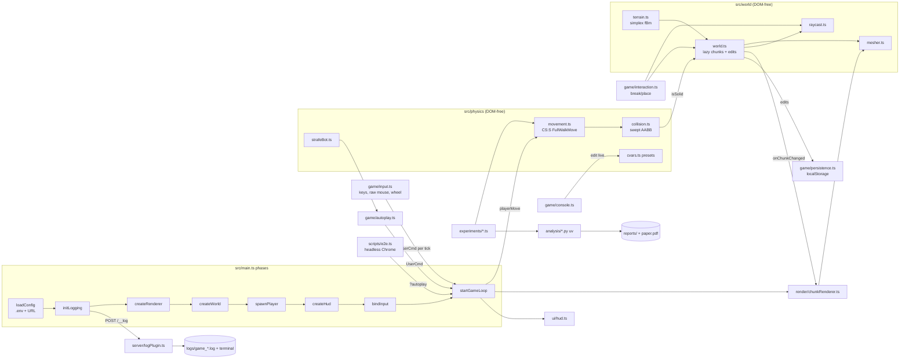

# BhopCraft — a browser Minecraft clone with Counter-Strike: Source bunnyhopping

BhopCraft is a Minecraft-style voxel game that runs in the browser (TypeScript + Three.js). You can break and place
blocks in an endless procedurally generated world, and the player moves with a port of the Counter-Strike: Source
movement code, so bunnyhopping and air-strafing work the way they do in CS:S.

**Features**
- **Voxel world:** endless seeded terrain (simplex-noise hills, trees, a flat 24-block spawn plaza for bhopping),
  chunk streaming, procedurally painted pixel-art textures.
- **Building:** break and place blocks, 9-block hotbar, edits saved per seed.
- **CS:S movement:**
  - Port of Source `FullWalkMove`: friction, accelerate, air strafing with the 30 u/s cap.
  - Anti-pogo or auto-bhop, the 110% bhop clamp, ducking and crouch-jumps.
  - Swept voxel collision.
- **CS:S feel:**
  - Raw mouse input at CS:S sensitivity scale, Hor+ FOV.
  - Mouse-wheel jump, a u/s speedometer, a backquote console for live cvars.
  - Two presets: `css_bhop` and `css_vanilla`.
- **Verification:**
  - 84 unit/integration tests.
  - `?autoplay` bot run that logs measured vs theoretical speed.
  - Headless-Chrome e2e test in CI.
  - Pre-registered experiments with a PDF paper ([reports/](reports/experiments_summary.md)).

## How it works (methodology)

- **Movement is CS:S movement.** [`src/physics/movement.ts`](src/physics/movement.ts) reimplements the algorithms
  of Valve's public Source SDK 2013 `CGameMovement` with CS:S constants. Each fixed tick:
  1. Half of gravity is applied.
  2. Jump is checked **before** friction.
  3. Friction runs only on ground ticks.
  4. The tick does ground accelerate or air accelerate.
  5. The game decides whether the player is now on the ground.
  6. The other half of gravity is applied.

  A jump on the landing tick therefore skips friction. In the air, acceleration is capped at 30 u/s *along the wish
  direction*, but not in total. That is why turning while strafing builds speed (bunnyhopping).
- **Units.** Physics runs in Source "Hammer units" (≈ inches) with z up. One block is 40 u, so the CS:S player
  (32×32×62 u, eyes at 64 u) is 0.8 × 0.8 × 1.55 blocks, and a jump (√(2·800·57) ≈ 302 u/s) clears one block.
- **Fixed tick.** Physics runs at a fixed tick rate (100 or 66.67 Hz, like Source servers) independent of frame
  rate; the camera is interpolated between ticks.
- **Verified against theory.** Optimal air-strafing must follow the closed form |v_n|² = |v₀|² + n·g
  ([J. W. Chong, strafing theory](https://www.jwchong.com/hl/strafing.html)), summed tick by tick with Source's
  surface-friction factor. The experiments measured a worst relative error of 1.0e-14 across 16 tick-rate ×
  air-acceleration settings (see "Experiments and results").
  Details of every step, constant and deviation: [docs/movement-physics.md](docs/movement-physics.md).

### Movement presets

| cvar | `css_bhop` (default) | `css_vanilla` |
|---|---|---|
| tick rate | 100 (0.01 s) | 66.67 (0.015 s) |
| `sv_airaccelerate` | 1000 | 10 |
| `sv_accelerate` / `sv_friction` / `sv_stopspeed` / `sv_gravity` | 5 / 4 / 75 / 800 | same |
| run speed / `sv_maxvelocity` | 250 / 3500 u/s | same |
| `sv_enablebunnyhopping` | 1 (no speed cap) | 0 (jumping clamps speed to 110% of run speed) |
| `sv_autobunnyhopping` | 1 (hold Space) | 0 (time your jumps; use the mouse wheel) |

`css_bhop` follows Momentum Mod's bhop mode. `css_vanilla` follows stock CS:S server defaults as documented
publicly (Valve Developer Community wiki, Momentum Mod's base mode).

## Install and run

Requirements: Node.js ≥ 20.19 (tested with 24.13) and npm. For `npm run e2e`: an installed Chrome or Edge (or set
`CHROME_PATH`). For the analysis/report scripts: [uv](https://docs.astral.sh/uv/).

```bash
npm install
```

```bash
cp .env.example .env
```

```bash
npm run dev
```

Open <http://localhost:5173> and click the window to capture the mouse.

| Command | What it does |
|---|---|
| `npm run dev` | Dev server with hot reload and the log-file endpoint |
| `npm test` | Unit and integration tests (Vitest, Node) |
| `npm run typecheck` | TypeScript type check |
| `npm run e2e -- --seconds 10 --preset css_bhop` | Starts Vite, runs the game in headless Chrome with autoplay, saves screenshots, checks the log |
| `npm run build` | Type check + static production build into `dist/` |
| `uv sync` then `npm run experiments` | Re-run both experiments, statistics, figures and `reports/paper.pdf` (deterministic seeds) |

## Controls

| Input | Action |
|---|---|
| Mouse | Look (raw input, CS:S scale: degrees = counts × 0.022 × sensitivity) |
| W A S D / arrows | Move |
| Space | Jump (hold to auto-bhop on `css_bhop`) |
| Mouse wheel | Jump for exactly one tick, like CS:S `bind mwheeldown +jump` |
| Ctrl / C | Duck (34% speed; ducking in the air tucks the feet up 17 u, so crouch-jumps reach higher) |
| Left / right mouse | Break / place block |
| 1–9 | Select hotbar block |
| R | Respawn on the spawn plaza |
| F | Fullscreen (also locks Ctrl+W and similar keys where the browser supports it) |
| ` (backquote) | Console: `sv_airaccelerate 100`, `preset css_vanilla`, `cvarlist`, `sensitivity 1.5`, `world_reset`, `help` |
| Esc | Release the mouse |

**How to bunnyhop:** run forward, jump, then in the air release W and hold A while moving the mouse smoothly left
(or D + right). Jump again the moment you land (hold Space on `css_bhop`, or scroll on `css_vanilla`). Alternate
sides each jump. The speedometer shows horizontal speed in u/s (run speed is 250).

## Configuration

- **Where settings live.** Everything is optional:
  - `VITE_*` keys in `.env` (template: [.env.example](.env.example)).
  - URL parameters (`?preset=`, `?seed=`, `?rd=`, `?log=`, `?autoplay=<seconds>`).
  - The in-game console for live changes.
- **What you can set.** Preset, seed, render distance, FOV, sensitivity, log level, and every movement cvar (e.g.
  `VITE_SV_AIRACCELERATE=100`).
- **Invalid values** fall back to defaults with a logged warning.
- **Saving.** Block edits are saved per seed in `localStorage`.

Full reference: [docs/configuration.md](docs/configuration.md).

## What happens when you run it

1. **Startup**, in [`src/main.ts`](src/main.ts) phases:
   - `loadConfig` reads `.env` and the URL.
   - `initLogging` sends log lines to the console, the terminal and `logs/game_<session>.log` via a Vite plugin.
   - `createRenderer` sets up WebGL with a z-up camera.
   - `createWorld` seeds the terrain, paints the texture atlas, and meshes the 113 chunks around spawn (~0.1 s).
   - `spawnPlayer` places you on the flat spawn plaza.
   - `createHud` builds the overlay.
   - `bindInput` connects keyboard and mouse.
   - `startGameLoop` starts the frame loop.
2. **Every frame:**
   - Real time becomes fixed physics ticks.
   - Each tick turns input (or the autoplay bot) into a `UserCmd` and calls `playerMove()`.
   - The camera eye is interpolated.
   - Chunks are streamed nearest-first within a 4 ms budget, and far ones are freed.
   - The block under the crosshair is outlined.
   - The HUD and scene are drawn.
3. **Block edits** change the world, which marks the edited chunk (and any neighbour that shares the face) for
   remeshing.
4. **Once per second** a `status` line is logged: fps, CPU ms per frame, ticks, jumps, speed, position and chunk
   stats.
5. **With `?autoplay=N`:**
   - A bot places and breaks a block.
   - It then strafe-jumps optimally for N seconds.
   - It logs `autoplay finished` with measured vs predicted speed.

## Architecture



Module responsibilities, data structures and measured performance: [docs/architecture.md](docs/architecture.md).

## Experiments and results

Two experiments were pre-registered (hypotheses and thresholds committed before running) and are documented in
[reports/](reports/experiments_summary.md), with a paper ([reports/paper.pdf](reports/paper.pdf)).
- **Exp. 1:**
  - Optimal strafing matches the closed form to 1.0e-14 in all 16 conditions.
  - A code review found that the first port left out Source's 0.25 air surface-friction rule. Our oracle had the same
    omission, so the tests could not catch it; it is now fixed, and both runs are reported.
  - Interventions isolate the mechanism: no strafing → no gain; a one-tick-late jump → ×0.96 speed per landing at
    100 tick.
  - Two predictions were falsified as stated and are explained in the report.
- **Exp. 2:**
  - A Markov model of Source's anti-pogo rule predicts the speed kept per landing under random scroll-wheel jumping.
  - All four Bonferroni CIs (200 runs each) contain the prediction.
  - The best pulse rate keeps 89% per landing at 66.67 tick.

## Project structure

| path | contents |
|---|---|
| `src/` | game: `physics/`, `world/`, `render/`, `game/`, `ui/`, `logging/`, `config.ts`, `main.ts` |
| `server/` | Vite plugin writing browser logs to `logs/` |
| `tests/` | Vitest unit + integration tests (mirrors `src/`) |
| `scripts/e2e.ts` | headless-Chrome end-to-end check |
| `experiments/`, `analysis/` | experiment runners (TypeScript) and statistics/figures/PDF (Python, uv) |
| `reports/` | experiment reports, data, figures, paper |
| `docs/` | physics, architecture and configuration references |

## Technologies

TypeScript, [Three.js](https://threejs.org/), [Vite](https://vite.dev/), [Vitest](https://vitest.dev/),
[simplex-noise](https://github.com/jwagner/simplex-noise.js) + [alea](https://github.com/coverslide/node-alea),
[puppeteer-core](https://pptr.dev/) (e2e only), Python + uv (analysis and report PDF only).

## Sources

- Valve, [Source SDK 2013](https://github.com/ValveSoftware/source-sdk-2013) `src/game/shared/gamemovement.cpp`.
  Movement algorithms are reimplemented, not copied.
- Valve Developer Community: [Dimensions](https://developer.valvesoftware.com/wiki/Dimensions_(Half-Life_2_and_Counter-Strike:_Source)) and [Bunnyhop](https://developer.valvesoftware.com/wiki/Bunnyhop).
- [Momentum Mod](https://github.com/momentum-mod/game): CS:S hull sizes, jump height and bhop-mode settings.
- J. W. Chong, [Half-Life Physics Reference: Strafing](https://www.jwchong.com/hl/strafing.html).
- three.js manual, [Voxel Geometry](https://threejs.org/manual/#en/voxel-geometry): faces table and ray traversal.
- Amanatides & Woo, "A Fast Voxel Traversal Algorithm for Ray Tracing", Eurographics 1987.

## License

MIT — see [LICENSE](LICENSE). Not affiliated with Valve or Mojang; all textures are generated procedurally.
