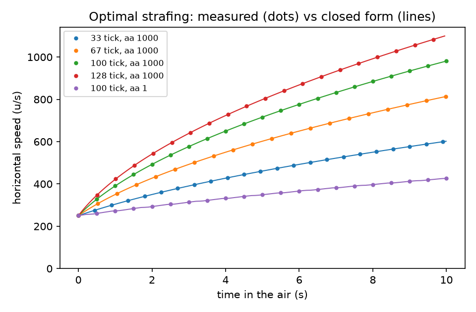
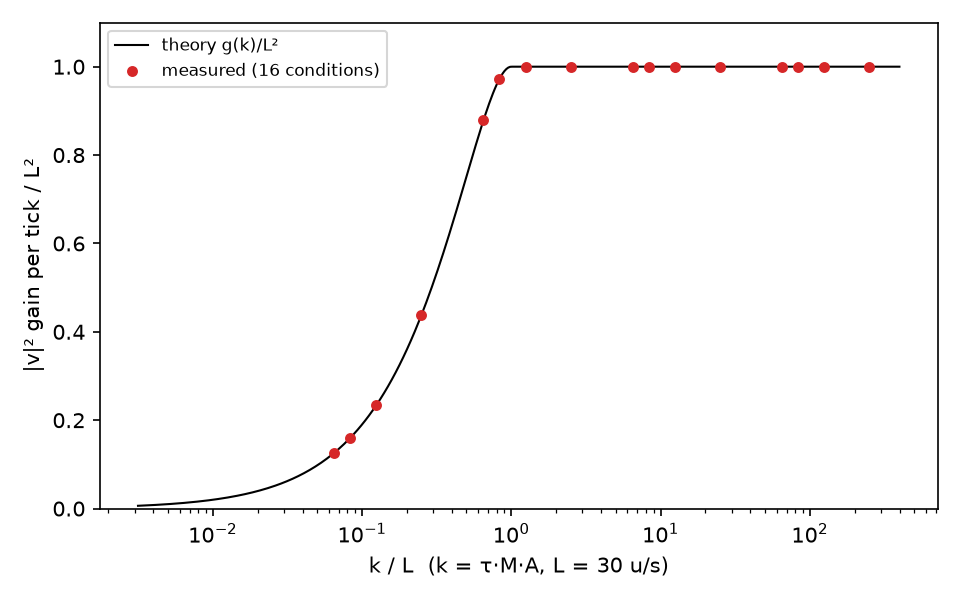
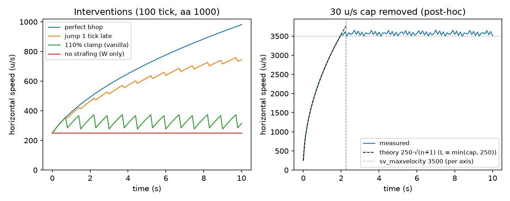
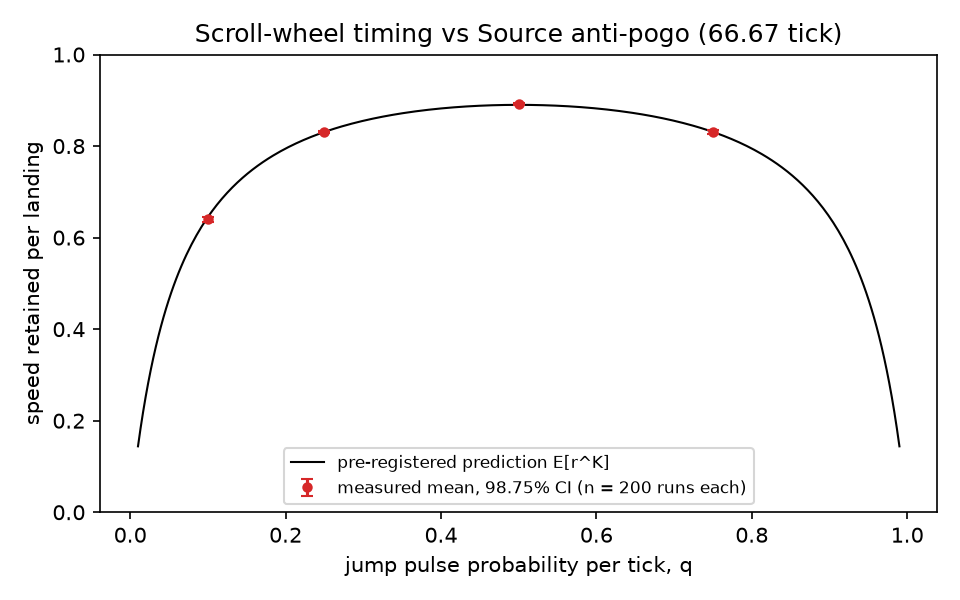

# Counter-Strike: Source bunnyhopping in a browser voxel game: a verified port of Source player movement

**Libor Burian**, independent researcher — October 2026 — code and data: https://github.com/BurnyCoder/minecraft-with-bunnyhopping

## Abstract

We port the player-movement algorithm of the Source engine (Valve's public Source SDK 2013 `CGameMovement`, with
Counter-Strike: Source constants) to TypeScript and embed it in a browser Minecraft-style voxel game. Two
pre-registered experiments test the port.

- **Experiment 1:** optimally strafed motion matches Chong's closed-form strafing theory, applied tick by tick with
  Source's surface-friction factor, to a worst relative error of 1.0 × 10⁻¹⁴ across 16 tick-rate × air-acceleration
  conditions. Causal interventions confirm that the gain needs both friction-free landings (a one-tick-late jump costs
  exactly 4% per landing at 100 tick) and strafing (holding W alone gives zero gain).
- **Experiment 2:** a two-state Markov model of Source's anti-pogo rule predicts how much speed is kept per landing
  with random scroll-wheel jumping. All four Bonferroni-corrected 98.75% CIs (200 runs each) contain the prediction.
- **Disclosure:**
  - Two confirmatory predictions were falsified as stated, by a prediction-derivation error and a test instrument
    error.
  - A code review found that the first port left out Source's rule that quarters acceleration while rising slowly in
    the air. Our oracle left it out too, so the two agreed with each other.
  - All of this is reported with the earlier data kept.

## 1. Introduction and motivation

- **The mechanism.** Bunnyhopping is a movement technique in Quake-derived engines: jumping on the landing tick
  avoids ground friction, and air-strafing adds speed while airborne [5]. It is a defining skill in Counter-Strike:
  Source (CS:S) community servers [5].
- **The goal.** A playable game in which a voxel world (break/place blocks, procedural terrain) is traversed with
  CS:S movement. Players should be able to rely on the movement matching the CS:S algorithm.
- **The method.** Instead of hand-tuning "bhop-like" physics, we reimplement the documented algorithm and test it
  against an independent closed-form theory [4], with pre-registered hypotheses.

**Contributions:**
1. An open-source TypeScript port of Source `FullWalkMove`, with CS:S constants and voxel collision.
2. Verification against strafing theory to float64 precision.
3. Causal interventions that isolate the bhop mechanism.
4. A falsifiable model of scroll-wheel jump timing under anti-pogo.
5. A worked example of how a shared-assumption oracle can hide a port defect.

## 2. Background

Per tick, Source movement [1] does the following:
1. Applies half of gravity.
2. Runs `CheckJumpButton`. A jump is refused if the player is airborne, or if jump was held on the previous tick
   ("don't pogo stick").
3. If still grounded, applies friction.
4. Runs `WalkMove` or `AirMove`.
5. Runs `CategorizePosition`, then applies the other half of gravity.

Because the jump check precedes friction, a jump on the first ground tick skips friction entirely.

**Air acceleration.**
- `AirAccelerate` adds at most k = k_e·A·M·τ along the wish direction, where A = `sv_airaccelerate` and M = wish
  speed. It does so only while the velocity's projection on that direction is below L = min(30 u/s, M).
- k_e is Source's `m_surfaceFriction`. `CategorizePosition` resets it to 1, and sets it to 0.25 when no ground is found
  while vz > 0 (rising, at most 140 u/s) [1, L3800, L3872–3877].
- Chong [4] derives the speed-maximising angle and the per-tick gain in squared speed:
  - g = L² if k ≥ L,
  - g = k(2L − k) otherwise,

  so |v_n|² = |v₀|² + Σ g(k_i).

**CS:S constants:** jump impulse √(2·800·57) u/s [3], hull 32×32×62 u (45 u ducked) [2, 3], gravity 800 u/s², run
speed 250 u/s.

**The bhop clamp.** In CS:S, `sv_enablebunnyhopping` (added 2010-08-17, default 0) controls a clamp of air velocity to
110% of run speed [5]. We apply it when a jump is made, following the public TF2 `PreventBunnyJumping` code [1] (TF2
uses 120%); this placement is our modelling choice.

## 3. Method

- **Game.**
  - TypeScript + three.js; physics in Hammer units with z up; 1 block = 40 u.
  - Fixed-tick simulation (`css_bhop`: 100 tick, A = 1000, auto-bhop; `css_vanilla`: 66.67 tick, A = 10, clamp) with
    interpolated rendering.
  - Collision is a swept AABB against 40 u blocks. It stops 1/32 u short of faces and zeroes the blocked velocity
    component, which is equivalent to `ClipVelocity` with overbounce 1 on axis-aligned planes.
- **Tests and verification.**
  - 84 unit/integration tests.
  - An in-browser autoplay mode logs measured vs predicted speed.
  - A headless-Chrome end-to-end test runs in CI.
  - One independent code-review pass.
- **Experiments.**
  - Hypotheses, metrics, thresholds and sample-size rules were committed to git before any run (commit `3a69dc7`).
  - Experiment 1 is deterministic: 16 conditions, τ ∈ {0.03, 0.015, 0.01, 0.0078125} × A ∈ {1, 10, 100, 1000}, 10 s
    each, plus four interventions.
  - Experiment 2 has 10 pilot seeds per q, which set n = 200 (the pre-registered cap), then 200 confirmatory seeds per
    q ∈ {0.1, 0.25, 0.5, 0.75}, 60 s each.
  - Statistics: t-intervals with Bonferroni correction over the four q values.

## 4. Results

**H1, closed form (Fig. 1–2).**
- The worst relative error in |v|² over all conditions and ticks is 1.0 × 10⁻¹⁴ (threshold 10⁻⁹). Repeat runs are
  bit-identical.
- About a quarter of air ticks run at k_e = 0.25.
- When even k/4 ≥ L (A ≥ 100), A no longer matters, and the gain per second scales with tick rate: 981 u/s at 100 tick
  vs 814 u/s at 66.67 tick after 10 s.
- At vanilla A = 10 the quartered ticks cost speed: 769.5 u/s at 66.67 tick.

**Interventions (Fig. 3).** At 100 tick / A = 1000, where k/4 > L, so these are unaffected by k_e:
- No strafing: speed stays exactly 250 u/s.
- One-tick-late jumps: speed is multiplied by 0.96 per landing (to 3 × 10⁻¹⁶); 746 vs 981 u/s after 10 s.
- With the clamp, the run maximum (378.31 u/s) respects the predicted bound (378.32).

Two predictions were falsified as stated:
- **End-of-jump-tick speed ≤ 275.** Measured 276.62. The clamp precedes that tick's air acceleration (+1.6 u/s), an
  error in our derivation.
- **Removing the 30 u/s cap causes immediate clamping.** It caused no gain. Our bot and prediction used L = cap rather
  than L = min(cap, M). After the fix (post-hoc), speed followed 250·√(n+1) exactly until the per-axis
  `sv_maxvelocity` clamp at tick 226.

**Exploratory.** A constant turn rate is best near 90 °/s at A = 10 and near 180 °/s at A ≥ 100 (100 tick). Faster
turning loses speed (Fig. 4 in the repository).

**H2, scroll timing (Fig. 5).** Measured retention per landing vs prediction (98.75% CI):

| q | measured | prediction |
|---|---|---|
| 0.1 | 0.6398 [0.6340, 0.6456] | 0.6451 |
| 0.25 | 0.8306 [0.8275, 0.8337] | 0.8308 |
| 0.5 | 0.8915 [0.8894, 0.8936] | 0.8900 |
| 0.75 | 0.8308 [0.8274, 0.8342] | 0.8308 |

- Every interval contains its prediction. The predicted maximum at q = 0.5 and the q ↔ 1 − q symmetry are visible.
- Final speeds after 60 s: 406 u/s at the best q vs 1782 u/s with auto-bhop.

## 5. Discussion and limitations

**Shared-assumption oracles.**
- Before the code review, the port and the closed-form oracle both used k_e = 1 and agreed to 9.4 × 10⁻¹⁵, although
  the port differed from Source.
- The review compared the port with the SDK source line by line and found the 0.25 rule. Correcting it changed 8 of
  the 16 conditions: those with A·M·τ/4 < 30.
- Exact agreement with theory therefore verifies only what the theory encodes. An independent read of the reference
  implementation remains necessary.

**What the agreement does and does not show.**
- We had no recordings from the CS:S binary.
- We used only public sources: the Source SDK 2013, Momentum Mod, and the Valve Developer Community wiki.

**Deliberate simplifications.**
- Instant ducking (Source animates it).
- No step-up (`StepMove`), because blocks are 40 u tall against an 18 u step. `StayOnGround` is kept.
- No water or ladders; block surfaces all have friction 1.
- float64 instead of float32 arithmetic.

**Experiment 2 caveats.**
- It uses an i.i.d. pulse model and no ground-tick keys, both simplifications of real play.
- At q = 0.1, the uncorrected 95% CI narrowly excludes the prediction. One candidate cause (post-hoc, untested) is
  friction becoming non-proportional below `sv_stopspeed`.
- The precision target (half-width 0.002) was not met at the 200-run cap.

## 6. Related work

- Chong's Half-Life physics reference [4] derives optimal strafing for the GoldSrc/Source family, including the k_e
  factor. We use it as the oracle.
- Momentum Mod [3] reimplements CS:S-style movement inside the Source SDK for speedrunning.
- The three.js manual's voxel geometry chapter [6] and Amanatides & Woo's traversal [7] underlie our mesher and block
  picking.

## 7. Conclusion

A small, test-driven port of Source movement reproduces the closed-form strafing dynamics exactly. It makes a
falsifiable prediction about scroll-wheel timing that survives a pre-registered test. The independent code review
caught the one defect that the theory-based tests could not see.

## References

1. Valve. Source SDK 2013, `src/game/shared/gamemovement.cpp`, `tf/tf_gamemovement.cpp`. https://github.com/ValveSoftware/source-sdk-2013
2. Valve Developer Community. Dimensions (Half-Life 2 and Counter-Strike: Source). https://developer.valvesoftware.com/wiki/Dimensions_(Half-Life_2_and_Counter-Strike:_Source)
3. Momentum Mod team. Momentum Mod game source (mom_gamemovement.cpp, mom_gamerules.cpp, mom_system_gamemode.cpp). https://github.com/momentum-mod/game
4. J. W. Chong. Half-Life Physics Reference: Strafing. https://www.jwchong.com/hl/strafing.html
5. Valve Developer Community. Bunnyhop. https://developer.valvesoftware.com/wiki/Bunnyhop
6. three.js manual. Voxel (Minecraft-like) Geometry. https://threejs.org/manual/#en/voxel-geometry
7. J. Amanatides, A. Woo. A Fast Voxel Traversal Algorithm for Ray Tracing. Eurographics 1987.

## Appendix: reproducibility

- **Software:** Node 24.13, TypeScript 7.0.2, three 0.186.1, Vitest 5.0.5, Python 3.13 with numpy, scipy 1.18.1,
  matplotlib (exact versions in `package-lock.json` and `uv.lock`).
- **Rerun:** `npm ci`, `uv sync`, then `npm run experiments`. Exp. 1 is deterministic, and Exp. 2 seeds are fixed
  (pilot 1000–1009, confirmatory 0–199).
- **Pre-registration:** `reports/exp01_strafe_theory.md` and `reports/exp02_jump_timing.md` at commit `3a69dc7`. Every
  deviation and every superseded run is listed in those files, and the superseded data is kept in `reports/data/`.
